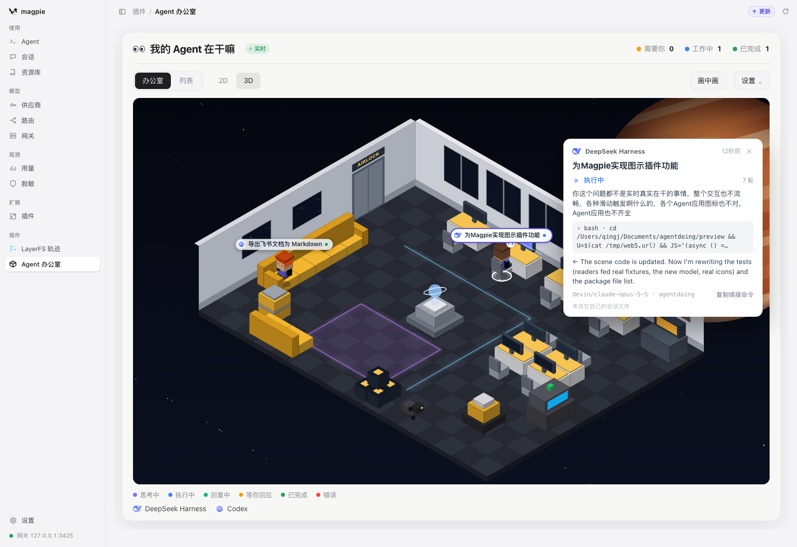

# Agent Office · 我的 Agent 在干嘛

A page in [magpie](https://usemagpie.ai)'s window that shows, live, what each of your coding agents is doing — read from the agents' own session files — as a little worker in a voxel space-station office (isometric 3D or top-down 2D) or as a list.


```sh
magpie plugin add QingJ01/magpie-agent-office
```

Then open **插件 › Agent 办公室** in the sidebar. Claude Code, Codex, DeepSeek Harness, Gemini CLI, Qwen Code, Pi, omp, Qoder, WorkBuddy and CodeBuddy show from their own session files, whatever model they use; any other agent shows while it works through magpie's models.

The repository carries the `magpie-plugin` topic, so magpie also lists it under **插件 › 发现 › 非官方插件 · GitHub**.

## Where a worker is, is what it is doing

| Status | Where | Sign |
|---|---|---|
| Thinking · 思考中 | at a desk | … |
| Running tools · 执行中 | at a desk, typing, its screen lit | spinner, how long it has run |
| Replying · 回复中 | at a desk | lines |
| Waiting for you · 等你回应 | in the purple square, waving | **!** |
| Done · 已完成 | on the sofa, asleep after 20 minutes | z |
| Error · 错误 | at the broken console | × |

The counts at the top are how many need you (waiting for an approval or an answer, failed, or stuck), how many are working and how many are done. Below, real sessions: DeepSeek Harness running a tool, Codex done on the sofa, the panel of the first opened by a click:



## How it knows

From each agent's **own session file**, as the agent writes it — not a guess from traffic. The plugin's host part (it runs in magpie's plugin host while magpie is open) reads them every 1.5 seconds, only what changed:

| Agent | File it reads |
|---|---|
| Claude Code | `~/.claude/projects/*/*.jsonl` |
| Codex | `~/.codex/sessions/YYYY/MM/DD/rollout-*.jsonl` (+ `session_index.jsonl` for titles) |
| DeepSeek Harness | `~/.dsh/sessions/*/*/session.v4.jsonl.zstd` |
| Gemini CLI · Qwen Code | `~/.gemini/tmp/*/chats/session-*`, `~/.qwen/tmp/*/chats/session-*` |
| Pi · omp | `~/.pi/agent/sessions/*/*.jsonl`, `~/.omp/agent/sessions/*/*.jsonl` |
| Qoder · WorkBuddy · CodeBuddy | their `projects/*/*.jsonl` (Claude Code's format) |

The `*_HOME` / `*_CONFIG_DIR` variables those agents honour are honoured here too. What each file says decides the status outright: a tool call with no result yet is **running**, an approval asked (Codex's `exec_approval_request`, DeepSeek Harness's `approval/asked`, Gemini's `awaiting_approval`) is **waiting for you**, a question tool is **asked you something**, the turn's end is **done**, an interruption is **stopped**, an error turn is **error**. A turn whose file hasn't moved for ten minutes is shown as stuck.

Every other agent (Cursor, OpenCode, Copilot, Kimi…) shows while it works through magpie: the module is also an [asynchronous gateway hook](https://usemagpie.ai/docs/plugins#gateway-request) that sees its requests. The hook returns no body, so no request changes.

Both write `page/live.js` beside the page, which the page loads every second (a plugin page has no network; its own files it may load). The green **live** dot by the title turns grey if the host stops writing.

All 60 agents magpie knows are named with their own icons, the files magpie itself shows (`page/icons`, from magpie's assets, MIT).

## Using it

Hovering only highlights a worker. **Click** a worker, its name tag or a row in the list to open its panel — the task, the last thing you asked, the step it's on, how its answer begins, its model and folder, **Copy resume command** — which stays at the side until you close it (✕ or Esc) or click another agent.

## Privacy

- It reads the agents' session files on this computer, only reads them, and only the last two days'. Through the gateway it records only requests made on this computer (magpie's `origin: local`) unless you set `"remote": true`.
- `live.js` holds the agent, the session id, the folder name and path, the model, the last prompt (200 characters), the first 280 characters of the last answer, and the names and targets of the last tool calls. It never holds a key, a header or a whole conversation. With `"text": false` (Settings › Show prompts and replies, off) it keeps statuses and tool names only.
- `live.js` stays in the plugin's folder and is never sent anywhere. The page asks magpie for no data at all: its `permissions` list is empty.

## Picture in picture

**Picture in picture** (画中画) lifts the office into a small window of the page's own, over the rest of it: drag its bar to move it, drag its corner to reshape it, click ✕ or press Esc to put it back. Only the agents that need you keep their name tags there; hover any of them for the card.


magpie frames a plugin's page with `allow=""` and `sandbox="allow-scripts"`, so the browser's own floating window (a `<video>`'s picture-in-picture, or `documentPictureInPicture`) is refused a page inside it — that was tried first, and it left nothing on screen. A window drawn in the page is not.


## Options

```json
{ "mode": "office", "dim": "3d", "demo": false, "showDone": true, "hideAfter": "6h", "text": true, "remote": false }
```

| Key | |
|---|---|
| `mode` | `office` or `list` |
| `dim` | `3d` or `2d` |
| `demo` | show sample agents (Settings › Sample agents) |
| `showDone` | keep finished agents on the sofa |
| `hideAfter` | when a finished or failed agent leaves: `1h`, `6h`, `24h`, `never` |
| `text` | keep prompts and replies (`false`: statuses and tool names only) |
| `remote` | the gateway part also records requests from other computers and gateway keys |
| `approvalAfterSec` | for an agent seen only through the gateway: how long its tools run before it counts as waiting for you (90) |

The page saves the first five as you change them; a change restarts the plugin's host (magpie's options do), so it waits until it has been left alone a moment.

## What it cannot know

- **An agent whose files it doesn't read and that doesn't use magpie's models.** It has no record here at all.
- **The model's word-by-word progress.** A file is written per message, so "replying" means the session's file is moving and the model has begun its answer.
- **Sessions older than two days**, or more than the latest 40: they are left out to keep each read cheap.

## Files

- `lib/readers.mjs` — each agent's session format turned into its phase, step, prompt and answer. No I/O.
- `lib/scan.mjs` — finds the files in each agent's folder and rereads only the ones that changed.
- `lib/track.mjs` — what the gateway hook keeps, from requests and replies in each API (Anthropic Messages, Chat Completions, Responses, Gemini). No I/O, so the tests drive it directly.
- `office.hooks.mjs` — the host part: scans every 1.5 s, sees the gateway's requests, writes `page/live.js`.
- `page/agents.js`, `page/icons/` — every agent magpie knows, with its own icon.
- `page/model.js` — statuses, counts, words (English and Chinese), agent marks, resume commands and sample agents, with no DOM.
- `page/scene.js` — the office, drawn on a canvas in isometric 3D or top-down 2D.
- `page/icons.js`, `page/app.js`, `page/index.html`, `page/style.css` — the page.

## Test

```sh
bun test
```

Checked in magpie 0.1.1318's own window (`magpie web`), in every view: 3D, 2D, list, and the window of its own.

## License

MIT
