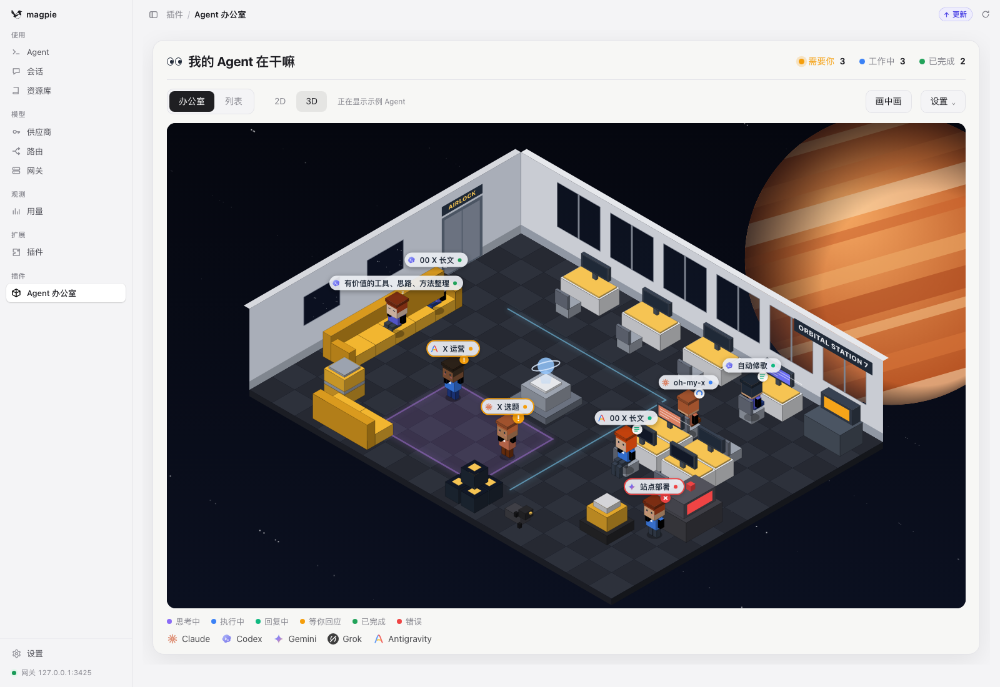
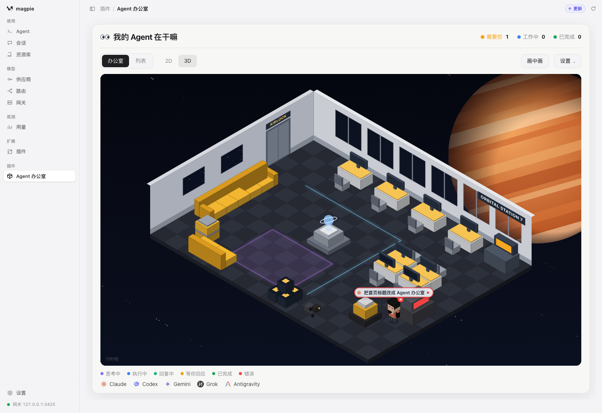
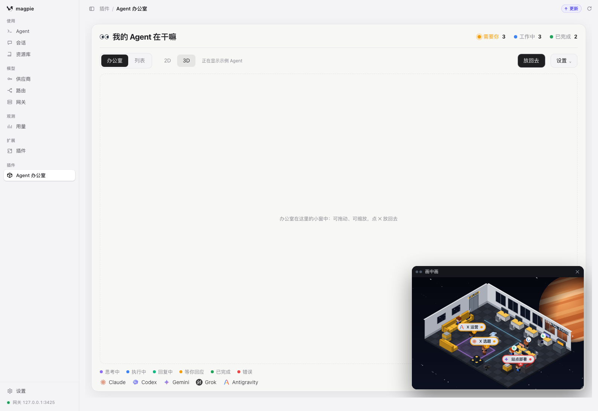
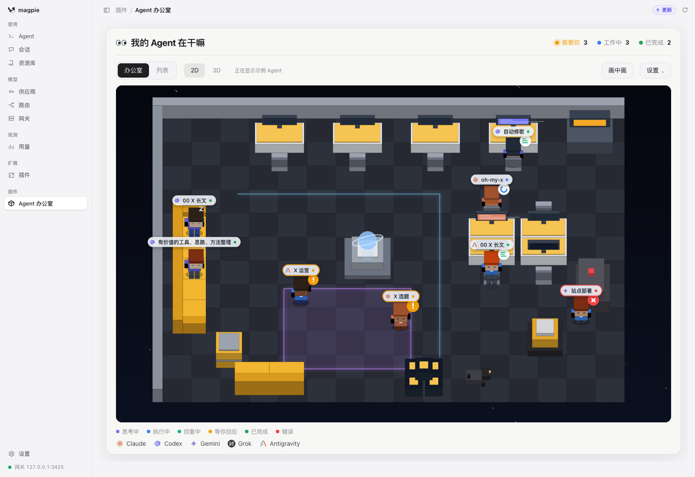
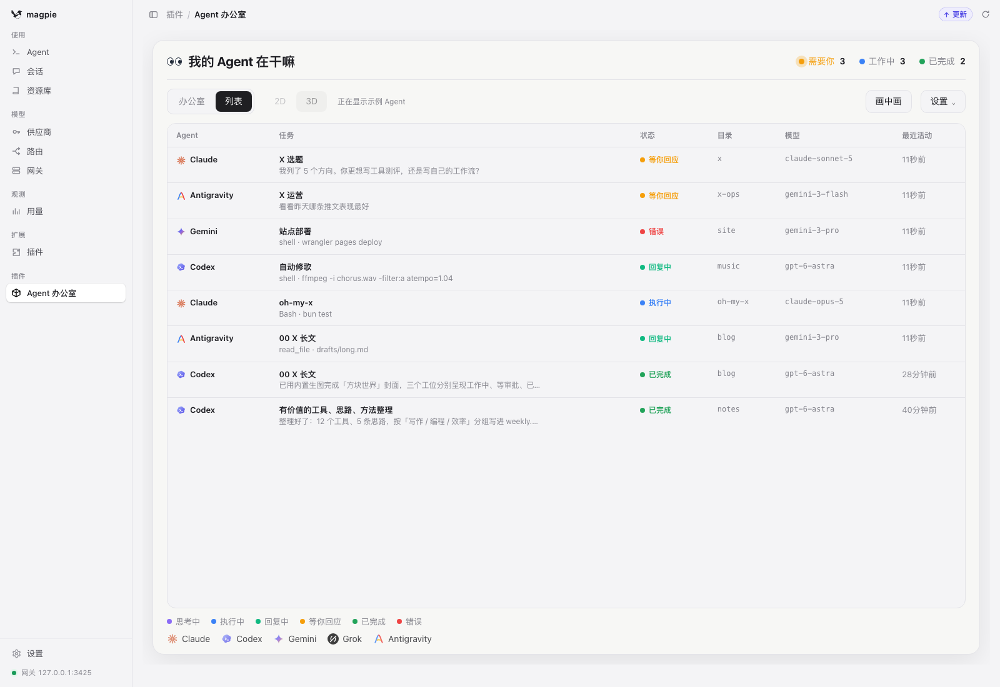

# Agent Office · 我的 Agent 在干嘛

A page in [magpie](https://usemagpie.ai)'s window that shows every agent working through magpie as a little worker in a voxel space-station office — in isometric 3D or top-down 2D — or as a list.



```sh
magpie plugin add QingJ01/magpie-agent-office
```

Then open **插件 › Agent 办公室** in the sidebar. Any agent whose model is a magpie model walks in on its next request: Claude Code, Codex, Gemini CLI, Grok, Antigravity, OpenCode, Pi, DeepSeek Harness and the rest.

The repository carries the `magpie-plugin` topic, so magpie also lists it under **插件 › 发现 › 非官方插件 · GitHub**.

## Where a worker is, is what it is doing

| Status | Where | Sign |
|---|---|---|
| Thinking · 思考中 | at a desk | … |
| Running tools · 执行中 | at a desk, typing, its screen lit | spinner, how long it has run |
| Replying · 回复中 | at a desk | lines |
| Waiting for you · 等你回应 | in the purple square, waving | **!** |
| Done · 已完成 | on the sofa, asleep after 20 minutes | z |
| Error · 错误 | at the broken console | × |

The counts at the top are how many need you (waiting for an answer, or failed), how many are working and how many are done. One real session, seen through a sandboxed magpie with no models signed in, so the request failed:



Hover a worker or click its name tag for a card with the agent, the task, the last thing asked, the last step it ran, how its answer begins, the model, and **Copy resume command** (`claude --resume …`, `codex resume …` and others).

## How it knows

The repository is one plugin with two parts:

- **`office.hooks.mjs`** — an [asynchronous gateway hook](https://usemagpie.ai/docs/plugins#gateway-request). magpie calls `onRequest` before routing each agent request and `onResponse` once its reply is complete. The hook **changes nothing**: it returns no body, so every request goes on exactly as it came. It records which session is at work, whether a request answers the user or a tool's result, and how the reply ended (tool calls, a question, plain text, or an error), and writes that to `page/live.js` in its own folder, at most four times a second.
- **`page/`** — the page. It runs in magpie's sandboxed frame with no network, and every few seconds loads `live.js` again (one of its own files). It works out each session's status against its own clock.

Sessions are told apart by the session id the agent sends (`X-Magpie-Session`, Claude Code's and Codex's own headers, and others). A request from an agent that sends none is grouped by its folder. A request without tools from a session that uses tools (a title or a summary) is a side request, so it doesn't count as the session's work.

## Privacy

- It only records requests made on this computer: magpie's `origin: local`. Requests through a gateway key or from other computers are left out unless you set `"remote": true`.
- `live.js` holds the agent, the session id, the folder name and path, the model, the last prompt (200 characters), the first 280 characters of the last answer, and the names and targets of the last tool calls. It never holds a key, a header or a whole conversation. With `"text": false` (Settings › Show prompts and replies, off) it keeps statuses and tool names only.
- `live.js` stays in the plugin's folder and is never sent anywhere. The page asks magpie for no data at all: its `permissions` list is empty.

## Picture in picture

**Picture in picture** (画中画) lifts the office into a small window of the page's own, over the rest of it: drag its bar to move it, drag its corner to reshape it, click ✕ or press Esc to put it back. Only the agents that need you keep their name tags there; hover any of them for the card.



magpie frames a plugin's page with `allow=""` and `sandbox="allow-scripts"`, so the browser's own floating window (a `<video>`'s picture-in-picture, or `documentPictureInPicture`) is refused a page inside it — that was tried first, and it left nothing on screen. A window drawn in the page is not.




## Options

```json
{ "mode": "office", "dim": "3d", "demo": false, "showDone": true, "hideAfter": "6h", "text": true, "remote": false, "approvalAfterSec": 90 }
```

| Key | |
|---|---|
| `mode` | `office` or `list` |
| `dim` | `3d` or `2d` |
| `demo` | show sample agents (Settings › Sample agents) |
| `showDone` | keep finished agents on the sofa |
| `hideAfter` | when a finished or failed agent leaves: `1h`, `6h`, `24h`, `never` |
| `text` | the hook keeps prompts and replies (`false`: statuses only) |
| `remote` | the hook also records requests from other computers and gateway keys |
| `approvalAfterSec` | how long tools run before the agent counts as waiting for you (90) |

The page saves the first five as you change them; a change restarts the plugin's host (magpie's options do), so it waits until it has been left alone a moment.

## What it cannot know

- **Only agents whose models are magpie's.** An agent that talks to its vendor directly never passes the gateway, so it has no session here. A plugin page may read only `usage:summary` and `providers:list`, and neither says what a session is doing.
- **A status is worked out, not reported.** The page infers it from what the gateway saw: a request out is thinking (replying once it has run more than 8 seconds), tool calls that have not come back are executing, and one that has sat 90 seconds is taken as waiting for an approval. `approvalAfterSec` moves that line; a step that genuinely runs long (a build, a test suite) reads as waiting until its result arrives, and its card says how long it has run.
- **The request is the boundary.** A tool the client runs itself is invisible: magpie sees the call, then nothing until the agent asks again.

## Files

- `lib/track.mjs` — what the hook keeps, from requests and replies in each API (Anthropic Messages, Chat Completions, Responses, Gemini). No I/O, so the tests drive it directly.
- `office.hooks.mjs` — the hook: calls the tracker, writes `page/live.js`.
- `page/model.js` — statuses, counts, words (English and Chinese), agent marks, resume commands and sample agents, with no DOM.
- `page/scene.js` — the office, drawn on a canvas in isometric 3D or top-down 2D.
- `page/icons.js`, `page/app.js`, `page/index.html`, `page/style.css` — the page.

## Test

```sh
bun test
```

Checked in magpie 0.1.1318's own window (`magpie web`), in every view: 3D, 2D, list, and the window of its own.

## License

MIT
